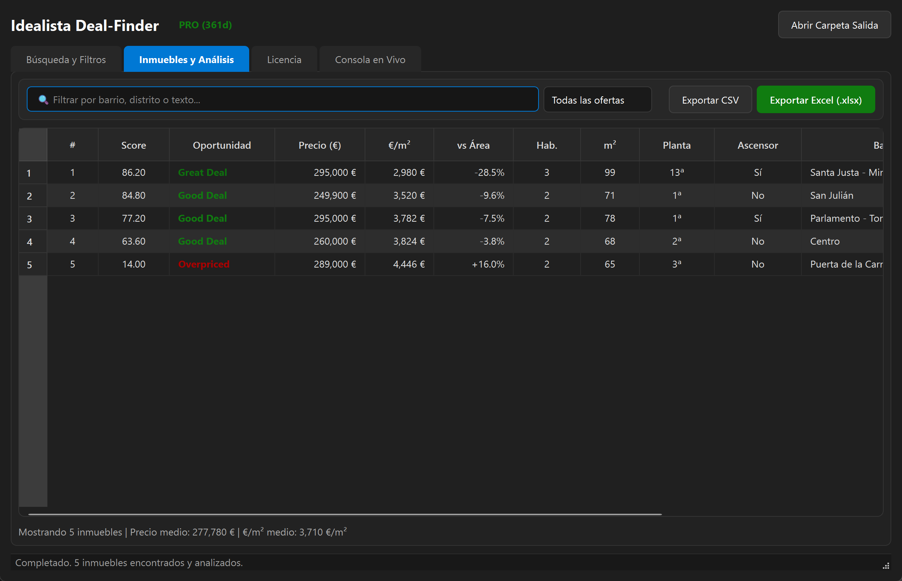

# Idealista Scraper Pro

Aplicación de escritorio y de consola para buscar viviendas en venta o alquiler en Idealista, comparar su precio con el de inmuebles similares y ordenar los resultados por puntuación. La interfaz permite seleccionar una provincia española o usar una URL de búsqueda propia.



## Empezar en Windows

### Versión portable

Abre `IdealistaScraper.exe` desde `release/IdealistaScraper-v1.0.0/`. Conserva junto al ejecutable la carpeta `browser/` con Chromium y el archivo `config.yaml`. La distribución incluye el navegador y las dependencias de Python.

### Desde el código fuente

Usa Python 3.11 o superior. Si no hay un Chromium portable disponible, la aplicación intenta abrir Google Chrome y, si falla, Microsoft Edge.

```powershell
python -m pip install -r requirements.txt
python app.py
```

También puedes abrir la interfaz con `.\run_gui.bat` o `python -m idealista --gui` desde la raíz del proyecto.

## Usar la interfaz

1. En **Búsqueda y Filtros**, elige provincia y operación o introduce una URL de Idealista. Ajusta los filtros de precio, habitaciones, superficie y ascensor.
2. Pulsa **Iniciar Extracción y Análisis**. Si el navegador muestra un captcha, resuélvelo en esa ventana para continuar. Puedes seguir el progreso en **Consola en Vivo**.
3. En **Inmuebles y Análisis**, consulta la tabla de resultados, abre las fichas y exporta a CSV o Excel (`.xlsx`).

La pestaña **Licencia** permite activar una clave vinculada al equipo. La aplicación se puede minimizar a la bandeja del sistema.

## Usar la consola

```powershell
python -m idealista --help
python -m idealista --max-price 400000 --min-rooms 2 --min-size 60
```

La configuración incluida busca viviendas en venta en Madrid, con un precio máximo de 305.000 €, un mínimo de dos habitaciones y una página de resultados. Puedes cambiar esos valores en `config.yaml` o sobrescribirlos para una ejecución con argumentos como `--url`, `--max-price` y `--min-rooms`. Si la búsqueda queda vacía, revisa el área y los filtros.

La consola muestra una tabla ordenada por puntuación y guarda un CSV en `data/output/` de forma predeterminada. Usa `--links full` para imprimir las URL completas y `--no-cache` para ejecutar la búsqueda sin leer ni actualizar la caché de fichas.

## Cómo se calcula la puntuación

El análisis toma la mediana del precio por metro cuadrado de inmuebles comparables. Busca primero en el barrio y amplía la referencia al distrito o a la ciudad cuando faltan comparables. Por defecto, las viviendas que quedan fuera del presupuesto también pueden contribuir a la referencia. Cada inmueble se excluye de su propia comparación.

La referencia se ajusta con características como ascensor, terraza, planta y estado de conservación. La tabla muestra un precio estimado, la diferencia porcentual respecto a ese valor y una puntuación de 0 a 100. En la columna `vs area` de la consola, un porcentaje negativo indica que el precio anunciado está por debajo de la estimación.

## Desarrollo

- `idealista/gui.py` y `idealista/cli.py` contienen los puntos de entrada de la interfaz y la consola.
- `idealista/pipeline.py` coordina la búsqueda, el análisis de mercado y la puntuación.
- `idealista/exporters.py` genera los archivos CSV y Excel de la interfaz.
- `build_windows_full.bat` prepara la distribución portable de Windows.

```powershell
python -m pytest tests
```
